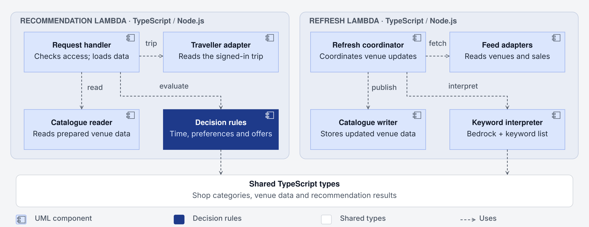
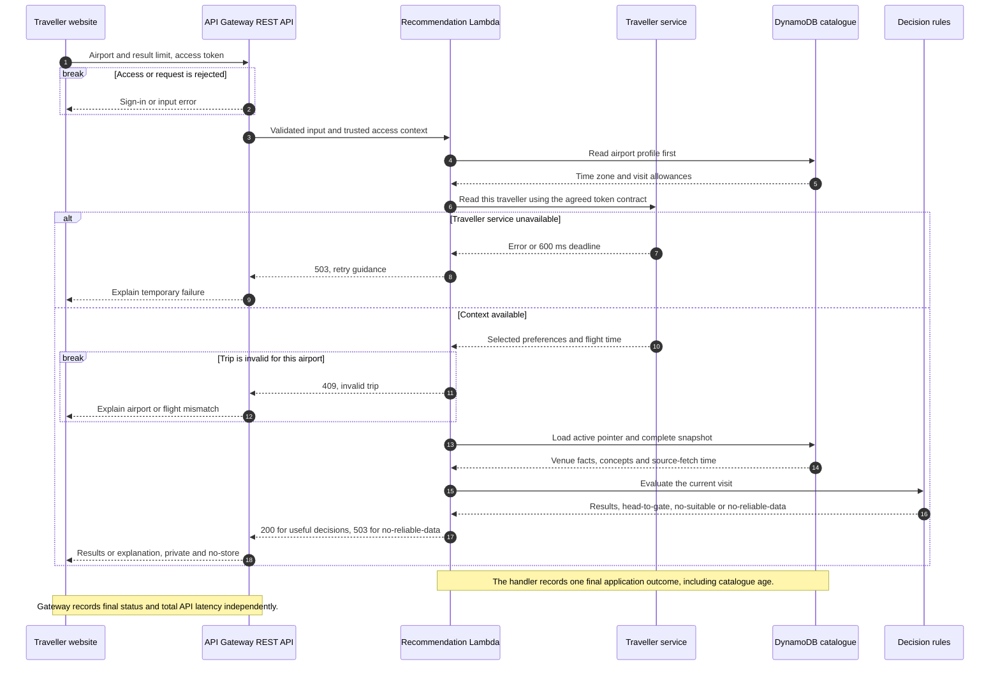
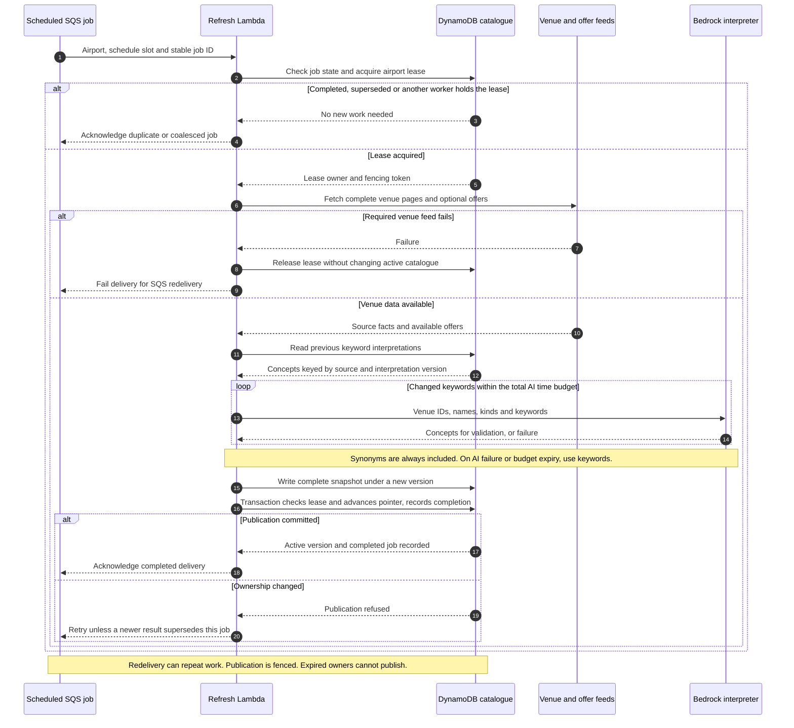
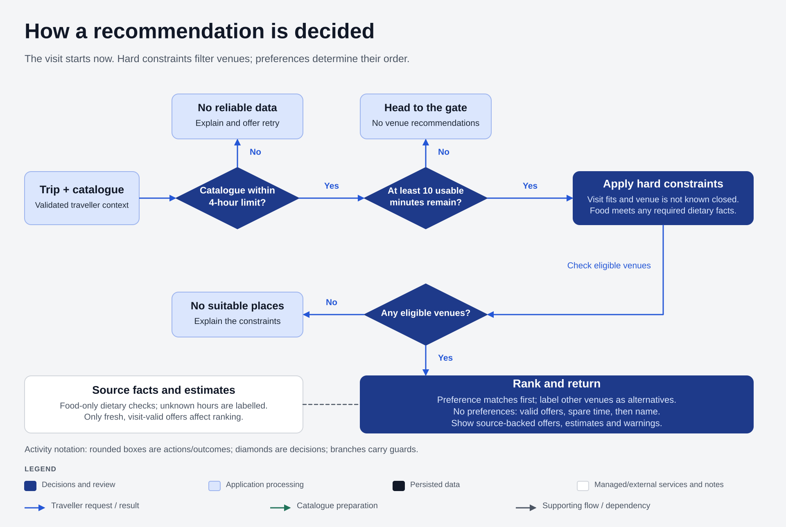
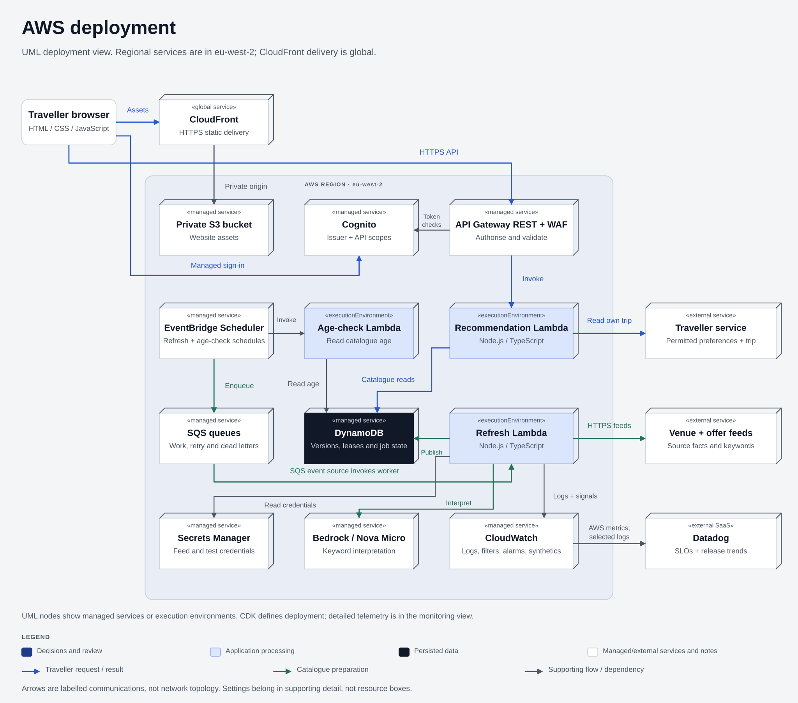
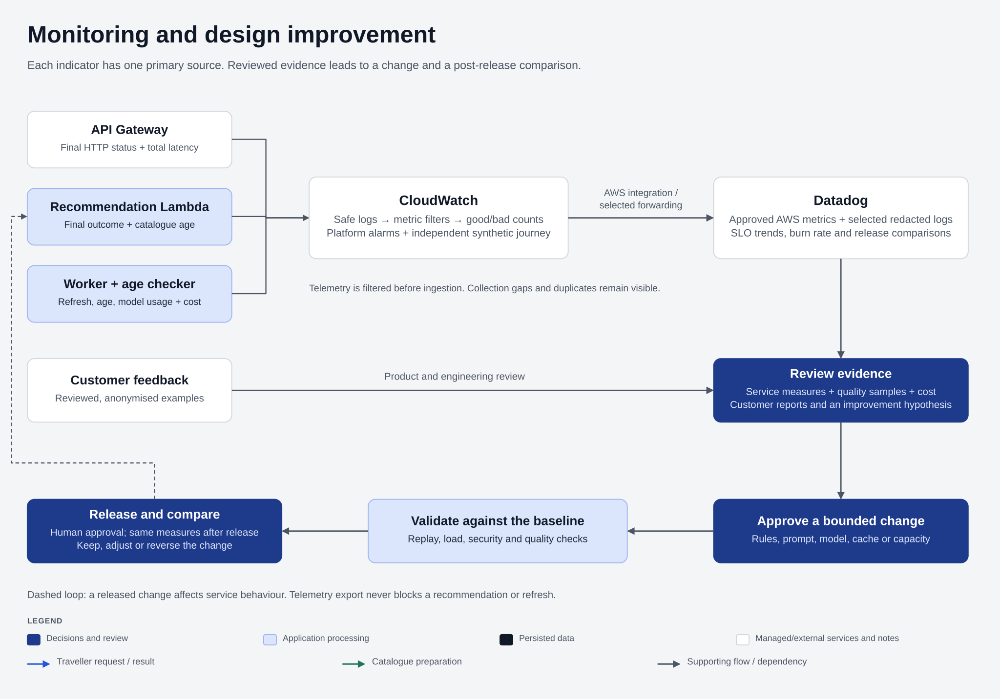

# Airport Trip Planner: supporting design detail

This document supports the [main proposal](solution-design.md). It contains six deeper views: the decision flow, components, two sequences, full deployment and monitoring. Contracts and validation support the headline decisions. The scope and numerical-assumption statement in the main proposal apply here too.

## Contents

1. [Components and request contract](#components-and-request-contract)
2. [Request sequence](#request-sequence)
3. [Catalogue preparation and publication](#catalogue-preparation-and-publication)
4. [Recommendation decisions](#recommendation-decisions)
5. [Time, preferences and source facts](#time-preferences-and-source-facts)
6. [Timing and capacity settings](#timing-and-capacity-settings)
7. [Deployment and identity](#deployment-and-identity)
8. [Measurement and monitoring](#measurement-and-monitoring)
9. [Security and data handling](#security-and-data-handling)
10. [Validation and standards](#validation-and-standards)

## Components and request contract

[Edit components](diagrams/solution-components.excalidraw) · [PNG](diagrams/solution-components.png)

The gateway authenticates access and validates the request shape. The request handler checks its trusted access context and coordinates reads. Adapters own network, storage and provider I/O. Pure decision rules receive the current instant, trip, airport profile and catalogue as inputs; they do not read the clock or call external systems themselves.

| Responsibility | Contract |
| --- | --- |
| Request handler | Receives airport ID and result limit, plus gateway-verified claims. Coordinates reads, enforces the application deadline and records the final outcome. |
| Traveller adapter | Reads only the authenticated traveller’s record under the agreed issuer/scopes contract; applies a subject-scoped cache, deadline and circuit breaker. |
| Catalogue reader | Loads the airport profile first; after trip validation, reads the active pointer and complete immutable snapshot. |
| Decision rules | Compute usable time, apply source-backed constraints, rank preferences and construct deterministic reasons. |
| Refresh coordinator | Acquires airport ownership, bounds preparation work and coordinates publication. |
| Feed adapters | Fetch all venue pages and optional offers; validate schemas, deduplicate records and retain source timestamps. |
| Keyword interpreter | Combines validated model concepts with keyword synonyms; never supplies safety or commercial facts. |
| Catalogue writer | Writes versioned records and atomically publishes the active pointer and completed-job state under the lease condition. |

Both Lambda functions use the same versioned vocabulary and data contracts. Interpretation reuse is keyed by normalised source keywords, venue kind, prompt, vocabulary and model configuration, so a model or policy change can invalidate cached labels.

`POST /recommendations` accepts an airport and a result limit up to ten. It never accepts replacement flight facts or another traveller’s subject. Useful outcomes (`ok`, `head-to-gate`, `no-suitable`) return HTTP 200. Missing or over-age catalogues return `no-reliable-data` with HTTP 503. Dependency errors return 503, invalid input 400, rejected access 401/403, and a mismatched or departed trip 409. Capacity rejection returns 429 and remains a service failure for measurement. Responses include catalogue age, timing assumptions and warnings, with `private, no-store`.

## Request sequence

[Mermaid source](diagrams/recommendation-sequence.mmd) · [SVG](diagrams/recommendation-sequence.svg)

The airport profile is read before traveller context, matching the overview’s “profile first” annotation. A missing profile fails clearly. The catalogue read follows validation of the traveller’s departure airport and flight time. Catalogue failure remains distinct from a valid decision that nothing is suitable. The browser uses a bounded retry with a clear waiting state instead of repeatedly submitting a failed request.

## Catalogue preparation and publication

[Mermaid source](diagrams/catalogue-refresh-sequence.mmd) · [SVG](diagrams/catalogue-refresh-sequence.svg)

EventBridge Scheduler enqueues an airport job every ten minutes. The stable job identity includes airport and schedule slot. A DynamoDB conditional lease permits one active preparation per airport. Deliveries already completed or superseded by a later successful fetch are acknowledged. A concurrent scheduled delivery is recorded as coalesced; the active owner or next schedule performs the refresh.

Required venue-feed failure leaves the previous catalogue active. Offers are optional: feed failure publishes venue data without offers. Every venue page must be fetched before a new catalogue is published. If source fetch or complete snapshot writes cannot finish within the job budget, publication is abandoned and the delivery fails for redelivery.

Only IDs, names, kinds and keywords reach Bedrock. Output validation checks JSON, requested IDs and permitted concepts, rejects repeated IDs and removes dietary or unsupported concepts. Accepted model labels are always unioned with deterministic synonyms. Empty concepts remain a ranking limitation rather than an exclusion. Provider errors, throttling and budget expiry stop further inference for that job; all remaining venues use keyword matching. Missing enrichment is retried in later refreshes.

A new version is allocated before its records are written. The active-pointer switch and completed-job record are committed in one DynamoDB transaction that checks the lease owner and fencing token. A worker that loses ownership cannot publish. Readers use strongly consistent reads for the pointer and the first load of a version, then cache that immutable snapshot. Partial versions never become active. A crash before commit leaves the old version active; a crash after commit is recognised by the job record on redelivery.

SQS handles redelivery after visibility expires, with exhausted deliveries sent to a dead-letter queue. There is no additional one/two/four/eight-minute retry schedule and no ten-minute per-job SLO. A new scheduled slot can run while a failed delivery waits; the airport lease prevents overlapping owners. A stale retry is skipped if a newer completed fetch already covers its schedule slot. Queue depth, oldest message, lease contention and catalogue age expose backlog.

| Record | Contents and lifetime |
| --- | --- |
| Airport profile | Time zone, accessible-area assumption and estimated boarding/walking allowances. |
| Active pointer | Complete catalogue version, source-fetch time and publication fencing token. |
| Catalogue version | Source venue/offer facts, original keywords, concepts, interpretation version and enrichment status. Superseded versions expire after 24 hours. |
| Airport lease | Owner, fencing token and expiry; ownership uses conditional comparisons, never TTL deletion. |
| Job record | Stable identity, completion/coalescing state and outcome; retained seven days, longer than the four-day work-queue retention. |

A dead-letter record is retained for 14 days. Redrive first checks current catalogue coverage; it does not blindly repeat old work. DynamoDB TTL is cleanup, not an immediate-deletion guarantee. The oldest required-feed fetch time, rather than publication time, determines catalogue age.

## Recommendation decisions

[Edit decision flow](diagrams/recommendation-flow.excalidraw) · [PNG](diagrams/recommendation-flow.png)

Matching venues form the first ranking tier. Other eligible venues remain clearly labelled alternatives, so an interpretation miss cannot silently remove them.

| Ranking input | Rule |
| --- | --- |
| Matched preference | +10 points; compound preferences require all constituent concepts. |
| Relevant offer | +5 for a matching venue, or when no preferences are selected. The catalogue must be fresh and the offer valid throughout the visit. |
| Tight timing | −5 when a visit uses more than 80% of available time. |
| Equal score | More spare time, then venue name. |

With no preferences, valid offers rank first, then spare time and name. The service returns results, `head-to-gate` below ten usable minutes, `no-suitable` when hard constraints exclude every venue, or `no-reliable-data` for missing or over-age catalogue data.

| Catalogue age | Behaviour |
| --- | --- |
| Under 30 minutes | Use venue facts and valid offers. |
| From 30 minutes through four hours | Warn about stale data and hide offers. |
| Beyond four hours, or missing | Return `no-reliable-data`. |

Reasons come from matched concepts and source fields. Timing and food-specific dietary checks follow the rules below.

## Time, preferences and source facts

The service is for a current airport visit. The website states this scope and assumes the listed venues are reachable from the traveller’s current airport area. Supporting future arrival would require an arrival instant and location context; the design does not infer them from flight departure.

Usable time is boarding-close minus now minus walking time. If boarding-close is absent, it is departure minus the 30-minute allowance. Service time uses a source duration when available; otherwise quick food/coffee takes 15 minutes, sit-down dining 45 and other visits 20. Missing inputs are labelled estimates. A non-positive result, or fewer than ten minutes, produces `head-to-gate`.

**Overnight example:** at 21:00 with a 07:00 flight tomorrow, an intended visit now is checked against tonight’s opening hours. A shop open only from 06:00 is not presented as open now. A request to plan tomorrow’s visit is outside scope. Overnight hours such as 20:00–02:00 are evaluated across the date boundary in the airport’s time zone. Offers must be valid from now through the estimated visit finish.

A required dietary condition applies only to food venues and must be backed by a venue-supplied field. A missing field means the food venue cannot be verified for that condition; it does not exclude a non-food shop. If no food venue has dietary data, the result explains that limitation and can still offer suitable shops. Unknown opening hours are warned about rather than represented as verified opening.

Preference matching operates on the union of synonyms and accepted model concepts. The matched tier sorts ahead of alternatives, then uses the main proposal’s scoring rules. With no preferences, dietary/time constraints still apply; valid offers rank first, then spare time and name. Without source prices, “affordable” describes a keyword match, not a monetary promise.

The product outcomes and HTTP codes are deliberately separate. `no-suitable` is a valid result after hard constraints; failure to load reliable inputs is a service failure. Missing offers never makes an otherwise useful recommendation fail.

## Timing and capacity settings

| Area | Coherent starting settings and consequence |
| --- | --- |
| Interactive path | Gateway-observed good response within 2 seconds; application budget 1.5 seconds; Lambda and gateway integration timeouts 3 seconds. The SLO permits a tail and is not a promise that every attempt finishes in 2 seconds. |
| Budget allocation | Traveller call at most 600 ms; profile and catalogue I/O share 400 ms; rules/serialization/handler overhead use the remaining 500 ms. An overall timer bounds the combined work. The 500 ms outside the application budget accommodates authorisation, cold start and transport; load tests check that allowance. |
| Caches | Traveller context 60 seconds per verified subject; pointer 30 seconds; airport profile five minutes. A warm runtime can therefore briefly lag a changed preference, flight or catalogue. The local circuit breaker opens after five source failures and probes after 30 seconds. |
| Refresh cadence | Ten-minute schedule; catalogue fresh under 30 minutes. Two missed opportunities have some margin before data becomes stale, depending on fetch and publication time. Freshness is measured, not inferred from the existence of the schedule. |
| Worker envelope | Application work budget 120 seconds within a 180-second Lambda timeout; source fetch up to 20 seconds, total inference up to 60, complete writes/commit up to 20, and 20 for orchestration/cleanup. Any stage can finish early; the total timer remains authoritative. |
| AI limits | At most 20 venues per call, 200 venues sent for inference per job, three model concepts per venue, 1,000 output tokens and 10 seconds per call. Calls stop when the 60-second aggregate inference budget expires, even if fewer than 200 venues were interpreted. All source venues still enter the snapshot with synonyms if source and write budgets permit. |
| Ownership | Airport lease lasts 240 seconds, exceeding the worker’s maximum runtime. Conditional fencing rejects an expired owner’s publication even if its late request arrives. |
| Queue handling | Batch size one, batching window zero, visibility 1,080 seconds (six times the 180-second function timeout), maximum receive count five. Scheduler delivery has its own dead-letter handling. These queue delays are not a refresh completion promise. |
| Capacity | Initial recommendation concurrency 50; refresh concurrency five, independently bounded. Source quotas and measured catalogue size determine final settings; no traffic capacity is claimed before load tests. |
| Retention | Superseded snapshots 24 hours; work queue four days; job records seven days; dead-letter records 14 days; redacted diagnostic logs 30 days in both monitoring systems. Audit retention is agreed separately. |

The availability objective is conditional on compatible upstream commitments. For example, allocating at most 0.05% bad attempts to the traveller dependency and 0.05% to the remaining path gives a combined 0.1% failure allowance. This is a budget allocation, not evidence that either service meets it. A 99.9% upstream uptime promise alone does not establish success within 600 ms. Unavailable or too-slow uncached context produces a measured failure; cached context is used only within its stated validity. If source commitments cannot support the objective, the service target or dependency design changes before adoption.

## Deployment and identity

The [main AWS view](diagrams/aws-overview.svg) groups access and scheduling services. The full view below adds the independent age checker, credential storage and their communications. Both describe the same regional design.

[Edit deployment](diagrams/solution-deployment.excalidraw) · [PNG](diagrams/solution-deployment.png)

CloudFront is global; S3, the regional REST API, Lambda, DynamoDB, Scheduler, SQS, Bedrock and Secrets Manager are placed in `eu-west-2`. The REST API choice supports the request validation and WAF integration in this design. Scheduler supplies both refresh jobs and a periodic catalogue-age check, without a separate EventBridge-rule mechanism. The age checker reads active pointers independently of the refresh worker, so stalled refreshes remain visible. CDK versions these resources and monitoring definitions.

**Identity contract:** Cognito is the proposed issuer and can federate an existing organisational identity provider. The browser signs in with the authorisation-code flow, PKCE and a bound state value. The REST API’s Cognito authorizer validates tokens from the configured user pool and requires the recommendation scope. The handler checks the gateway-verified `token_use=access` and permitted `client_id` claims before trusting the subject. Signature, issuer and expiry belong to token validation; access-token client identity is not assumed to be an ID-token `aud` claim.

The traveller service receives the bearer access token only if it trusts this issuer and the agreed traveller-read scope; it independently authorises its own-record endpoint. Scope consent covers both required APIs. If that service uses another issuer, direct forwarding is not enabled: a delegated token exchange or a service credential with an audited subject mapping must be agreed and added to the adapter contract. Browser-supplied identities are never accepted as that mapping. Cognito is therefore an explicit integration assumption, not a second identity system imposed on an existing service.

The API role reads profiles and catalogues. The refresh role reads sources, calls the selected model and writes versioned data and job state. The age-check role reads pointers and emits measurements. Any feed credentials are retrieved by the refresh function from Secrets Manager. Monitoring collection has read-only, scoped access. DynamoDB point-in-time recovery and retained tables support recovery within the initial single-region boundary; recovery time/data-loss objectives need product agreement and restore tests.

## Measurement and monitoring

[Edit monitoring](diagrams/monitoring-feedback.excalidraw) · [PNG](diagrams/monitoring-feedback.png)

Each service indicator has one primary source. There is no hidden reconciliation service and no join required between access logs and application logs.

| Indicator | Source and calculation | Coverage |
| --- | --- | --- |
| Useful availability | Gateway terminal access records for `POST /recommendations`. Good = HTTP 200. Bad = 5xx, capacity 429 and other unexpected statuses. Explicit input/access/trip rejections (400/401/403/409) and known abuse blocks are excluded. | Includes integration failure and handler timeout visible to Gateway. Dependency failure and `no-reliable-data` use 503, so cannot appear as good empty results. Gateway does not prove browser delivery or answer relevance. |
| Response speed | Same access records. Good = useful HTTP 200 with gateway response latency at most 2,000 ms; all remaining service attempts are bad. | Measures the API boundary, including authorisation and integration. Browser rendering/network experience is checked separately with the synthetic journey. |
| Fresh decision context | One final structured application outcome per handler invocation, after a valid trip is loaded. Good = readable catalogue with age under 30 minutes; bad = missing, stale or unreadable catalogue. | Attempts that die without a final application outcome have unknown freshness and are covered as failures by the gateway indicator. They do not become fresh samples. |

The handler owns its final outcome event. Gateway owns terminal access records. CloudWatch metric filters convert each source into good/bad counts, using separate metric names so log forwarding and AWS integration cannot count the same signal twice. Datadog’s AWS integration collects those metrics for the rolling objectives. The age-check function independently publishes catalogue age; platform alarms cover queue backlog, dead letters, throttling, worker errors and model limits. Refresh completion and model spend remain diagnostic measures rather than extra SLOs.

This first release uses log-derived indicators, not an exactly-once telemetry ledger. CloudWatch metric filters can occasionally deliver duplicates. Opaque extended request IDs and invocation IDs support coverage checks and offline recalculation when duplicates or gaps are detected; affected windows are treated as uncertain until checked. No-traffic periods have no request ratio, and missing telemetry is not success. A CloudWatch Synthetics authenticated journey with a dedicated test account checks sign-in, recommendation response and catalogue warnings independently. Failed probes or a mismatch between source records and counts trigger investigation. A durable deduplicating aggregator is a later option if traffic or reporting requirements justify it.

CloudWatch retains operational alarms while Datadog provides SLO trends, burn-rate views and release comparisons. Approved metrics use a restricted AWS integration; selected redacted logs use separately configured forwarding. Export delay and gaps stay visible. Neither exporter failure nor Datadog outage blocks traveller requests or catalogue publication.

Product and engineering review service trends, quality samples, model spend and customer reports. A change records the problem, affected quality goal and expected evidence of improvement. Versioned rules, prompts or capacity settings are replayed against the same baseline, reviewed and rolled out with rollback available. The same SLIs are compared after release. Reviewed, anonymised failures become regression cases. Exhausted error budget shifts priority to reliability; security incidents retain their own urgency. Monitoring and reports inform decisions but do not authorise release.

## Security and data handling

The browser, source services, AWS workloads, model and Datadog form separate trust boundaries. Private S3 origin access, HTTPS, least-privilege roles and managed secrets protect them. Tokens stay in browser memory; personalised responses cannot enter shared caches. The permitted web origin, CSP and plain-text rendering reduce script and brand-content risks.

Model input contains only venue identifiers, names, kinds and keywords. Personal preferences, trip records, credentials, offers and source dietary facts never enter classification prompts. Constrained JSON and concept validation limit authority, but do not prove semantic correctness: adversarial keywords are included in evaluation. The model cannot make a dietary assertion authoritative or override the deterministic time rules.

Telemetry uses an allowlist: service, environment, airport, outcome, duration, catalogue age/state and configuration version. Tokens, customer identifiers, flight details, preferences, request bodies and raw prompts/replies are excluded before ingestion. Opaque request/job identifiers are restricted diagnostic fields, not high-cardinality metric dimensions. Seeded sensitive strings test filtering, including dependency exceptions. Synthetic-test credentials are held in Secrets Manager and never logged.

The proposed 30-day diagnostic retention applies to CloudWatch and Datadog separately. The selected Datadog site, external-provider retention, access controls and security-audit retention need agreement. AWS London placement does not establish external-service data residency. Expiry settings are distinguished from physical deletion guarantees.

## Validation and standards

| Quality attribute | Mechanism | Validation |
| --- | --- | --- |
| Performance | No request-time AI; bounded reads and application deadline. | Cold/warm requests, cache misses, slow sources and API-boundary timing. |
| Reliability and freshness | Complete versions, fenced publication, redelivery handling and age checks. | Crash before/after commit, expired leases, duplicate jobs, failed feeds and missing catalogues. |
| Scalability | Separate request/refresh capacity, cached snapshots and coalesced per-airport work. | Burst traffic, source quotas, queue backlog and catalogue growth against job budgets. |
| Security and privacy | Trusted access context, scoped endpoints and roles, source-only safety facts and redaction. | Cross-user requests, wrong issuer/client/scope, prompt injection, credential rotation and exported-record inspection. |
| Recommendation quality | Preference ranking, synonym union and deterministic constraints. | Empty concepts, no preferences, ambiguous keywords, missing dietary fields and human relevance judgements. |
| Maintainability | Pure rules, explicit adapters and versioned contracts/configuration. | Unit, contract and architecture checks; regression replay before rule or prompt changes. |
| Accessibility | Understandable outcomes, labelled estimates and keyboard-operable UI. | Keyboard, screen-reader, zoom, focus, status announcements and error recovery. |
| Cost and observability | Reused interpretations, bounded AI work and separate signal sources. | Tokens/retries per job, cost per changed venue, log/metric coverage, export delay and retention. |

Model evaluation compares synonyms alone with model-plus-synonyms on the same independently labelled holdout. Before sampling, the team agrees a practically useful improvement margin and confidence level; sample size follows expected class frequency and the comparison, rather than a fixed 200-venue minimum. Report precision and recall by category with confidence intervals, inspect regressions and keep ambiguous/adversarial examples separate. If a small set cannot establish the agreed margin, evidence is inconclusive and the synonym baseline remains the initial choice. Regardless of aggregate scores, incorrect dietary authority, forbidden access or unsafe time handling fails the release gate.

The three riskiest end-to-end checks are: a current visit across overnight opening/offer boundaries; two refresh deliveries plus a crash around publication; and an authenticated attempt to read another traveller’s context. They are supplemented by malformed model replies, partial feed pages, provider throttling, browser outcomes and restore exercises. All checks validate the design; none is described as an already achieved production result.

| Guidance | Design application | Verification |
| --- | --- | --- |
| [AWS Well-Architected](https://docs.aws.amazon.com/wellarchitected/latest/framework/the-pillars-of-the-framework.html) | Separate capacity, bounded dependencies, least privilege, complete snapshots and measurable improvement. | Load, failure, cost and restore exercises; agree recovery objectives. |
| [OWASP ASVS 5.0.0](https://asvs.owasp.org/) and [prompt-injection guidance](https://genai.owasp.org/llmrisk/llm01-prompt-injection/) | Scoped identities, safe rendering, data minimisation and limited model authority. | Select applicable controls; test access boundaries, sign-in and untrusted content. |
| [WCAG 2.2](https://www.w3.org/TR/WCAG22/) | Proposed AA baseline for the interface. | Automated and manual checks for applicable criteria, including keyboard access, focus and status messages. |
| [Google SRE](https://sre.google/workbook/implementing-slos/) | User-facing good/bad indicators and review of error-budget use. | Verify coverage, exclusions, source reliability and no-data handling. |
| [AWS API choices](https://docs.aws.amazon.com/apigateway/latest/developerguide/http-api-vs-rest.html) and [Cognito verification](https://docs.aws.amazon.com/cognito/latest/developerguide/amazon-cognito-user-pools-using-tokens-verifying-a-jwt.html) | REST API for WAF/validation; explicit issuer, app-client and access-scope contract. | Integration tests with the actual issuer and traveller service. |
| [Lambda/SQS configuration](https://docs.aws.amazon.com/lambda/latest/dg/services-sqs-configure.html) | Visibility at least six times function timeout, bounded ownership and redelivery-safe publication. | Slow invocation, throttle, expired owner and redrive tests. |
| [CloudWatch metric filters](https://docs.aws.amazon.com/AmazonCloudWatch/latest/logs/MonitoringLogData.html) and [Datadog SLOs](https://docs.datadoghq.com/service_level_objectives/metric.md) | Explicit source-to-count ownership; metric-based good/bad objectives and visible collection limitations. | Duplicate/gap detection, latency thresholds and metric-query checks. |

These references guide a design assessment; they do not establish certification or completed conformance. Source contracts, upstream commitments, recovery objectives, applicable controls, external data handling and monetary AI budget remain decisions to agree.

[Return to the main proposal](solution-design.md)
