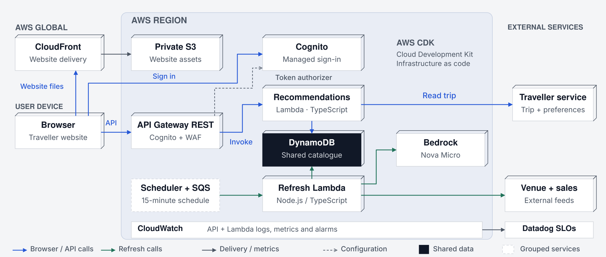
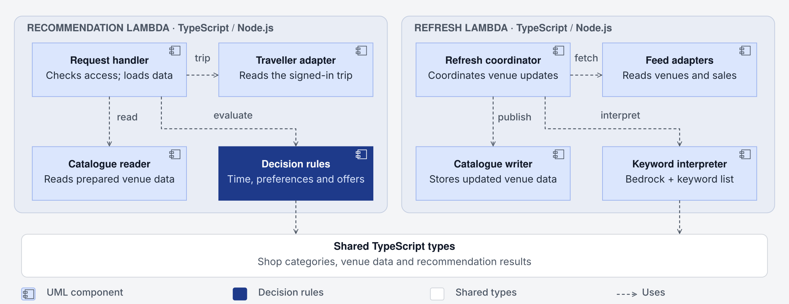
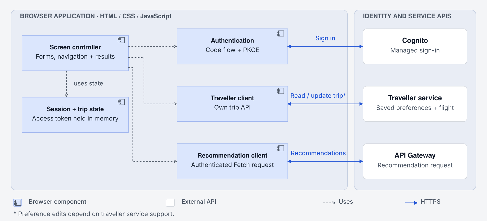

# Airport Trip Planner: solution design

The planner recommends airport restaurants and shops using preferences, flight time and sales. A pre-built AI model interprets shop descriptions in the background. Prepared venue information is then reused for fast recommendations, even when AI is unavailable. Incorrect venue information and estimated visit times can affect the results.

## 1. AWS infrastructure

[Edit in Excalidraw](diagrams/aws-overview.excalidraw) · [PNG](diagrams/aws-overview.png)

### Technology choices and trade-offs

| Technology | Reason and trade-off |
| --- | --- |
| Private S3 + CloudFront | Static hosting without servers. A regional outage interrupts recommendations. |
| API Gateway REST, Cognito + WAF | Handles sign-in and protects API access. Assumes the traveller service accepts Cognito access tokens. |
| Lambda + DynamoDB | Functions scale separately. Each reads a complete version of the venue data. Starting a new function instance adds delay. |
| EventBridge Scheduler + SQS | Schedules venue updates every 15 minutes per airport (design setting). The queue buffers work when updates take longer. |
| Bedrock (Nova Micro) | A pre-built AI model interprets the different words brands use to describe their shops. This avoids training a model, but adds running costs. |
| CloudWatch + Datadog | Monitor availability, response time and how current the venue information is. |

## 2. Backend components

[Edit in Excalidraw](diagrams/solution-components.excalidraw) · [PNG](diagrams/solution-components.png)

### Recommendation rules

The visit starts now within one accessible airport area.

| Input | Effect on recommendations |
| --- | --- |
| Flight time | Recommend places the traveller has time to visit before boarding. |
| Preferences | Show matching places first. Dietary requirements use information supplied by the venue. |
| Sales | Promote valid offers among suitable places. Without preferences, places with offers appear first. |
| Brand descriptions | Recognise that different words can mean the same thing. For example, “cheap” and “budget” both describe an affordable option. |

### Technology and quality objectives

TypeScript / Node.js provides shared data types for both functions. Decision rules are separate from network and storage code, so they can be tested independently.

| Quality goal | Measure and 30-day design target |
| --- | --- |
| Availability | At least 99.9% of valid, authorised requests return recommendations, gate advice or an explanation that no suitable venue is available. Failures in the planner or its dependencies count as unavailable. |
| Response time | At least 95% of the same requests return a useful result within two seconds, measured at API Gateway. Delays in the traveller service affect this target. |
| Current venue information | At least 99% of requests that check venue data use information updated within the last 30 minutes. |

## 3. Frontend design

The browser shows the traveller’s trip and supports preference edits if the traveller service accepts updates. The backend reads the trip independently and never trusts flight or preference values sent by the browser.

[Edit in Excalidraw](diagrams/frontend-design.excalidraw) · [PNG](diagrams/frontend-design.png)

### Browser technology choices

| Technology | Reason and trade-off |
| --- | --- |
| HTML / CSS / JavaScript | A small, static website with no framework to maintain. A framework would make a larger website easier to organise and maintain. |
| Cognito + PKCE | Handles sign-in; the APIs limit each traveller’s access to their own trip. Tokens stay in memory, so reloading restarts the browser session. |
| DOM + semantic HTML | Shop descriptions cannot insert HTML into the page. Labelled controls, keyboard navigation and clear status messages support accessibility. |
